<p align="center">
  
</p>

<p align="center">
  <a href="https://www.anypayx.com"></a>
  <a href="https://www.npmjs.com/package/@anypay/anypayx.com"></a>
  <a href="https://github.com/anypay/anypayx.com/blob/master/LICENSE"></a>
  <a href="https://nextjs.org"></a>
  <a href="https://www.typescriptlang.org"></a>
</p>

<p align="center">
  <a href="https://www.anypayx.com">Website</a> ·
  <a href="https://www.anypayx.com/docs">Docs</a> ·
  <a href="https://api.anypayx.com/api">API</a> ·
  <a href="https://www.anypayx.com/walletbot">WalletBot</a> ·
  <a href="https://github.com/anypay">GitHub</a> ·
  <a href="https://www.anypayx.com/auth/signup">Sign Up</a>
</p>

---

## What It Is & Purpose

**anypayx.com** is the official web platform for Anypay — a production Next.js 15 app serving as the marketing site, merchant dashboard, and developer documentation hub. It's where merchants create accounts, manage invoices, configure API keys, monitor payments, and integrate crypto payment capabilities into their businesses.

The site provides the full user experience: onboarding flows, authentication (Auth0, Supabase), real-time payment tracking, webhook configuration, WalletBot setup, and comprehensive developer guides. It connects to the core Anypay API (`api.anypay.com`) and the checkout UI (`checkout.anypayx.com`) to deliver a complete payment platform.

Built with Next.js App Router, TypeScript, Material-UI, Tailwind CSS, and Supabase, it's deployed on Vercel and handles production traffic for merchants accepting Bitcoin, Ethereum, Solana, XRP, and stablecoins (USDC, USDT, RLUSD, NUSD) across 13+ blockchains.

## Why Use It

**anypayx.com** is the front door to Anypay's crypto payment infrastructure. Without it, merchants would have no dashboard to manage invoices, no documentation to integrate the API, and no place to sign up for accounts.

- **Who it's for:** Merchants, developers, and businesses wanting to accept cryptocurrency payments; existing Anypay users managing their accounts and payments; developers integrating the Anypay API or exploring SDKs.
- **Where it fits:** The marketing and product face of Anypay. It sits above the core API (`anypay/anypay`), generates invoices that render in the checkout UI (`web3-checkout-vite`), and provides the documentation that developers use to integrate SDKs (`anypay-sdk`) and plugins (`anypay-woocommerce`). It's the starting point for the entire payment flow.

**Key value propositions:**
- Single-page sign up with instant API key generation
- Real-time payment dashboard with webhook logs and invoice history
- Comprehensive developer docs with code samples for REST API, SDKs, and WebSockets
- WooCommerce plugin download and setup guides
- Mobile app (iOS/Android) download links for point-of-sale
- WalletBot configuration for automated self-custody payment settlement
- Live cryptocurrency price feed display

## How It Works

<p align="center">
  
</p>

**anypayx.com** orchestrates the full merchant and developer experience:

1. **Merchant creates invoice** — Via the dashboard (`/in/apps`) or directly through API keys (`/developer/api-keys`), merchants generate invoices with an amount, currency, and description. The site calls `api.anypay.com/v1/invoices` and returns a `webpage_url`.

2. **Customer views checkout** — The invoice URL loads the checkout UI (`checkout.anypayx.com`) in an embedded iframe or redirect. The customer sees supported chains, selects their wallet (MetaMask, Phantom, Crossmark, Unisat, Xverse, Yours), and scans a QR code or connects their browser wallet.

3. **On-chain payment** — The customer broadcasts a transaction (BTC, ETH, USDC on Ethereum/Solana/etc.) to the blockchain. Anypay's chain monitors detect the transaction and confirm it meets the invoice amount and address.

4. **Confirmation & settlement** — Once confirmed, Anypay marks the invoice paid, fires a webhook to the merchant's configured endpoint (`/developer/webhooks`), and displays success on the checkout UI. If the merchant uses WalletBot, funds can be automatically swept to cold storage or forwarded to another address.

The Next.js app renders all of this: the sign-up flow, dashboard, API documentation (`/docs`), WebSocket documentation (`/docs/websockets`), WooCommerce plugin page (`/woocommerce`), WalletBot setup (`/walletbot`), and live price feed (`/prices`).

## Quickstart / How to Use It

### Prerequisites
- Node.js 18+ and npm/yarn
- A Supabase project (for authentication and database)
- Auth0 application (optional, for OAuth)
- API keys for integrations (Mapbox, Firebase, etc.) if using those features

### Installation

```bash
# Clone the repository
git clone https://github.com/anypay/anypayx.com.git
cd anypayx.com

# Install dependencies
npm install
# or
yarn install
```

### Environment Variables

Create a `.env.local` file (not committed) with the following keys. The app uses Auth0 and Supabase for authentication:

```bash
# Auth0 (for OAuth)
AUTH0_CLIENT_ID=your_auth0_client_id
AUTH0_DOMAIN=your_auth0_domain

# Supabase (for auth and database)
NEXT_PUBLIC_SUPABASE_URL=https://your-project.supabase.co
NEXT_PUBLIC_SUPABASE_ANON_KEY=your_supabase_anon_key

# Firebase (optional, for analytics/messaging)
FIREBASE_API_KEY=your_firebase_key
FIREBASE_PROJECT_ID=your_firebase_project_id

# Mapbox (for maps)
MAPBOX=your_mapbox_token
```

### Development Server

```bash
# Run the dev server on port 8081
npm run dev
# or
yarn dev
```

Open [http://localhost:8081](http://localhost:8081) in your browser. The landing page, authentication flows, and dashboard routes are all available.

### Build for Production

```bash
npm run build
npm run start
```

### Available Scripts

| Command | Purpose |
| --- | --- |
| `npm run dev` | Start development server on port 8081 |
| `npm run build` | Build the production Next.js app |
| `npm run start` | Serve the production build |
| `npm test` | Run Jest tests |
| `npm run lint` | Run ESLint |
| `npm run lint:fix` | Auto-fix ESLint issues |

### Key Routes

| Route | Description |
| --- | --- |
| `/` | Marketing landing page (hero, features, CTA) |
| `/auth/signup` | Create a new Anypay account |
| `/auth/login` | Log in to existing account |
| `/in` | Merchant dashboard (invoices, apps, payments) |
| `/in/api-keys` | Manage API keys for REST API access |
| `/in/webhooks` | Configure webhook endpoints |
| `/developer/prices` | Live cryptocurrency price feed |
| `/docs` | Developer documentation hub |
| `/docs/websockets` | WebSocket API documentation |
| `/walletbot` | WalletBot setup and automation guide |
| `/woocommerce` | WooCommerce plugin download and instructions |

### Integration Example

Create an invoice via the Anypay API (which this site documents):

```javascript
// From the landing page code example
const response = await fetch('https://api.anypay.com/v1/invoices', {
  method: 'POST',
  headers: {
    'Authorization': 'Bearer YOUR_API_KEY',
    'Content-Type': 'application/json'
  },
  body: JSON.stringify({
    amount: 100,
    currency: 'USD',
    description: 'Premium Subscription'
  })
})

const { invoice } = await response.json()
console.log(`Invoice URL: ${invoice.webpage_url}`)
```

The API key comes from `/developer/api-keys` on this site, and the invoice renders in the checkout UI linked from this platform.

## Next Moves for Growth

High-leverage, repo-specific improvements grounded in the current state of `anypayx.com`:

1. **Upgrade to Next.js 15 canary features** — The app is on Next.js 15, but `experimental.typedRoutes` and `experimental.serverActions` are enabled. Test the new App Router stability features (Partial Prerendering, React 19 Server Components) and migrate any remaining Pages Router code (the `_pages/` folder suggests legacy routes). Remove `next-transpile-modules` if no longer needed with the new bundler.

2. **Environment variable drift** — `.env.sentry-build-plugin` is tracked (should be `.gitignore`). The Sentry auth token is exposed in the repo; rotate it and add `.env.sentry-build-plugin` to `.gitignore`. Also create a `.env.example` file showing required variables (Auth0, Supabase, Mapbox, Firebase) so new contributors know what to configure.

3. **Migrate legacy TypeScript errors** — Multiple pages use `// @ts-ignore` suppressions (13+ instances in `page.tsx` alone). These hide type errors for Link `href` props and other issues. Run `tsc --noEmit` to surface them, fix the actual type mismatches, and remove the suppressions. This will catch runtime errors before they ship.

4. **Optimize bundle size** — The dependency list is large (100+ packages). Run `npm run build` and check the bundle analysis. Consider lazy-loading heavy components (react-map-gl, deck.gl, Prism, ApexCharts) with `next/dynamic` to reduce initial page load. The landing page loads deck.gl and mapbox-gl even if users never scroll to a map.

5. **Add end-to-end tests** — The repo has Jest unit tests (`npm test`) but no Cypress/Playwright E2E tests for critical flows: sign-up, login, create invoice, configure webhook, generate API key. Add a `tests/e2e/` folder with Playwright tests covering these paths so deploys don't break auth or payment creation.

6. **Document the dual-auth setup** — The app uses both Auth0 and Supabase for authentication. The docs don't explain when each is used or how to switch providers. Add a `docs/AUTHENTICATION.md` file clarifying the architecture: which routes use Auth0 vs. Supabase, how session management works, and how to test locally without both providers.

7. **Consolidate dark mode implementation** — The theme uses MUI `themeMode: 'dark'` (from `config.ts`), but Tailwind overrides in `globals.css` define a separate dark marketing token set, and the landing page hardcodes `bg-[#111]`. Unify these: either use MUI's dark palette everywhere or fully migrate to Tailwind CSS variables. Right now, components can render inconsistent grays.

## Anypay Ecosystem & License

**anypayx.com** is part of [Anypay](https://www.anypayx.com) — Bitcoin & Stablecoin payments for business. Merchants and developers use Anypay to accept BTC, ETH, XRP, Solana, and stablecoins such as USDC, USDT, RLUSD, and NUSD through invoices, APIs, SDKs, webhooks, WooCommerce, and mobile POS.

| Project | Role |
| --- | --- |
| [anypay](https://github.com/anypay/anypay) | Invoice & payments platform / API (`@anypay/server`) |
| [anypay-sdk](https://github.com/anypay/anypay-sdk) | TypeScript SDK for browser & Node.js (`@anypay/client`) |
| [web3-checkout-vite](https://github.com/anypay/web3-checkout-vite) | Current checkout UI (`checkout.anypayx.com`) |
| [walletbot](https://github.com/anypay/walletbot) | Self-custody headless wallet (`@anypay/walletbot`) |
| [merchant-app](https://github.com/anypay/merchant-app) | iOS & Android point-of-sale |
| [anypay-woocommerce](https://github.com/anypay/anypay-woocommerce) | Official WooCommerce plugin |
| [prices.anypayinc.com](https://github.com/anypay/prices.anypayinc.com) | Real-time cryptocurrency price feed service |

### Supported Chains & Assets

Anypay supports 13+ blockchains and their native assets, plus major stablecoins:

- **Bitcoin** (BTC), **Bitcoin Cash** (BCH), **Bitcoin SV** (BSV)
- **Ethereum** (ETH), **Polygon** (MATIC), **Avalanche** (AVAX), **Binance Smart Chain** (BNB)
- **Solana** (SOL), **XRP Ledger** (XRP), **Stellar** (XLM)
- **Dogecoin** (DOGE), **Litecoin** (LTC), **Dash** (DASH)
- **Stablecoins:** USDC, USDT, RLUSD (Ripple USD), NUSD (across multiple chains)

### License

No `LICENSE` file is currently present in the repository. The package.json does not specify a license field. If this code is intended for public or open-source use, the maintainers should add a `LICENSE` file (MIT, ISC, Apache 2.0, or other) to clarify usage rights. Until then, default copyright applies: © Anypay, all rights reserved.

---

<p align="center">
  <a href="https://www.anypayx.com"></a><br/>
  <sub>Bitcoin & Stablecoin Payments For Business · <a href="https://www.anypayx.com">anypayx.com</a> · <a href="https://x.com/xanypay">@xanypay</a></sub>
</p>
